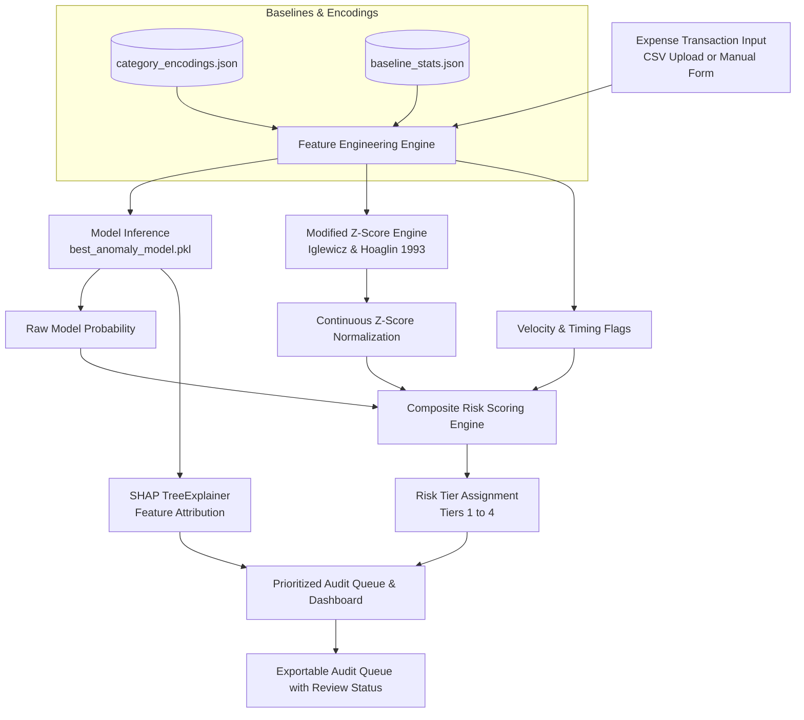

# Expense Intelligence Platform — Audit Analytics

An AI-assisted corporate expense risk prioritization and audit analytics platform. The system analyzes corporate expense transactions, calculates statistical deviations from historical employee and category baselines, predicts anomaly likelihood using a gradient-boosted tree ensemble model, and generates an explainable, prioritized audit queue for compliance officers and auditors.

> **Disclaimer**: This system prioritizes transactions for audit review based on statistical risk indicators. It does not determine policy violations or misconduct. Final audit decisions remain with the authorised human auditor.

---

## Table of Contents
1. [Overview & Core Architecture](#overview--core-architecture)
2. [Project Structure](#project-structure)
3. [Machine Learning & Scoring Methodology](#machine-learning--scoring-methodology)
   - [Feature Engineering Pipeline](#feature-engineering-pipeline)
   - [Robust Statistical Deviation (Modified Z-Score)](#robust-statistical-deviation-modified-z-score)
   - [Composite Risk Score Calculation](#composite-risk-score-calculation)
   - [Risk Routing Protocol (Tiers)](#risk-routing-protocol-tiers)
4. [Explainability (SHAP)](#explainability-shap)
5. [Application Features](#application-features)
   - [Tab 1: Overview Dashboard](#tab-1-overview-dashboard)
   - [Tab 2: Transaction Risk Analysis](#tab-2-transaction-risk-analysis)
6. [Installation & Setup](#installation--setup)
7. [Running the Application](#running-the-application)
8. [Input Data Specifications](#input-data-specifications)
9. [Configuration Artifacts](#configuration-artifacts)

---

## Overview & Core Architecture



---

## Project Structure

```
Financial_Expense_Anomoly_Detection_for_Corporate_Auditing/
├── app.py                     # Main Streamlit application and UI interface
├── best_anomaly_model.pkl     # Trained tree-based anomaly detection ensemble model
├── baseline_stats.json        # Historical per-category medians, MADs, and spend percentiles
├── category_encodings.json    # Label-encoding maps for categorical fields
├── feature_columns.json       # Exact 28 feature column order expected by the model
├── threshold_config.json      # Optimal decision threshold and precision/recall metrics
├── requirements.txt           # Pinned production Python dependencies
├── sample_test_expenses.csv   # Curated sample expense ledger for testing
└── README.md                  # Project documentation
```

---

## Machine Learning & Scoring Methodology

### Feature Engineering Pipeline
The platform transforms raw transaction fields into **28 engineered features** expected by the pre-trained gradient-boosted tree model:

1. **Categorical Encodings**:
   - `department`: Operations, Sales, Engineering, Finance, HR, Administration, Marketing
   - `employee_role`: Role designation code
   - `expense_category`: Food, Travel, Equipment, Hotel, Client Meeting, Entertainment, Office Supplies, Training, Communication, Transportation
   - `payment_method`: Corporate Card, Company Account, Reimbursement
   - `vendor`, `business_purpose`, `approval_status`: Metadata features
2. **Amount Transformations & Ratios**:
   - `log_amount`: Log-transformed transaction value ($\ln(1 + \text{amount})$)
   - `amount_to_emp_cat_ratio`: Ratio of current transaction to employee's historical category average
   - `amount_to_cat_avg_ratio`: Ratio of current transaction to company-wide category benchmark
   - `mtd_spend_share`: Ratio of current transaction to total month-to-date employee expenditure
3. **Temporal & Policy Heuristics**:
   - `hour`: Transaction submission hour (0–23)
   - `day_of_month`: Calendar day (1–31)
   - `day_of_week`: Day index (0=Monday, 6=Sunday)
   - `is_weekend`: Flag for Saturday/Sunday submissions
   - `is_off_hours`: Binary flag for late-night window submissions (1:00 AM – 4:00 AM)
   - `is_late_night`: Binary flag for evening/night submissions ($\ge 22$ or $\le 5$)
   - `is_month_end`: Flag for transactions filed during month close ($\ge 26$)
4. **Behavioral Flags**:
   - `is_smurfing_band`: Identifies amounts falling in the range ₹9,500 – ₹9,999 (just below the standard ₹10,000 corporate approval ceiling)
   - `is_round_number`: Identifies suspiciously round transactions ($\ge ₹5,000$ and divisible by ₹1,000)
   - `is_reimbursement`: Out-of-pocket personal payments
   - `high_velocity_flag`: Elevated submission velocity ($\ge 12$ claims submitted this month)
   - `modified_z_score`: Robust statistical distance from category norms

---

### Robust Statistical Deviation (Modified Z-Score)
Rather than standard Z-scores (which are distorted by extreme outliers and skewed expenditure distributions), the system calculates Boris Iglewicz and David Hoaglin's (1993) **Modified Z-Score**:

$$M_i = 0.6745 \times \frac{x_i - \tilde{x}}{\text{MAD}}$$

- $x_i$: Transaction amount
- $\tilde{x}$: Historical population median for the expense category
- $\text{MAD}$: Median Absolute Deviation ($\text{median}(|x_i - \tilde{x}|)$)
- $0.6745$: Normal-consistency multiplier

---

### Composite Risk Score Calculation
To combine model intelligence with heuristic risk indicators, a weighted composite risk score is evaluated:

$$\text{Composite Score} = 0.50 \cdot P(\text{model}) + 0.25 \cdot z_{\text{norm}} + 0.15 \cdot \text{velocity\_flag} + 0.10 \cdot \text{off\_hours\_flag}$$

Where $z_{\text{norm}}$ is mapped through a continuous exponential saturation curve:

$$z_{\text{norm}} = 1.0 - \exp\left(-\frac{\max(M_i, 0)}{20.0}\right)$$

This formulation ensures:
- **Strict Monotonicity**: Every additional rupee claimed yields a strictly higher score, preventing score collisions.
- **Natural Ceiling**: Bounded asymptotically in $[0.000, 1.000]$.

---

### Risk Routing Protocol (Tiers)

| Tier | Category | Composite Score Range | Audit Routing Protocol |
|---|---|---|---|
| **Tier 1** | **Critical Risk** | $\text{Score} \ge 0.85$ | Immediate audit escalation and receipt verification |
| **Tier 2** | **High Risk** | $0.70 \le \text{Score} < 0.85$ | Expedited review before reimbursement approval |
| **Tier 3** | **Moderate Risk** | $0.55 \le \text{Score} < 0.70$ | Routine sample audit queue |
| **Tier 4** | **Low Risk** | $\text{Score} < 0.55$ | Standard automated processing |

---

## Explainability (SHAP)

The platform integrates **SHAP (SHapley Additive exPlanations)** via `shap.TreeExplainer` to interpret model predictions:
- **Primary Risk Drivers**: Factors contributing positively to the risk score, with descriptions and normalized contribution percentages.
- **Other Contributing Factors**: Residual minor risk drivers combined into an aggregated card so all risk-elevating contributions sum to **100%**.
- **Mitigating Factors**: Attributes that align with normal patterns and lower the risk score.
- **Waterfall Plots**: High-resolution attribution charts showing the transition from the base expected score to the final prediction.

---

## Application Features

### Tab 1: Overview Dashboard
- **Batch CSV Ingestion**: Upload corporate ledgers with automatic schema validation.
- **Sample Template Download**: Built-in button to download a valid CSV template.
- **Executive KPI Cards**: Total Expenses, Transactions Analysed, High-Risk Transactions, and Escalation Rate.
- **Risk Distribution Charts**:
  - Donut chart displaying all 4 tiers across all analysed transactions.
  - Progress bars showing exact counts and percentages per tier.
- **Analytics Visualizations**:
  - Horizontal bar chart of high-risk transactions by department with integer axis ticks.
  - Total risk exposure by expense category.
  - High-risk transactions distributed by day of the month.
  - Average expense amount per category.
- **Interactive Prioritized Audit Queue**:
  - Multi-select filters for Department, Expense Category, and Risk Tier.
  - Top-K slider to control queue size.
  - Dynamic table height fitting records without empty whitespace.
  - 1-based **Rank** column with default 0-based index hidden.
  - **Editable Review Status** (`Pending`, `Confirmed`, `Dismissed`) powered by `st.data_editor` and persisted in `st.session_state`.
  - **Export Queue**: Download the prioritized queue to CSV including updated auditor decisions.
- **Auditor Deep-Dive**: Select any transaction from the queue to view its dedicated SHAP explanation and waterfall plot.

### Tab 2: Transaction Risk Analysis
- **Interactive Evaluation Form**: Test individual expense submissions before approval.
- **Load Sample High-Risk Transaction**: Pre-fills the form with a curated anomaly scenario.
- **Input Validation**: Rejects invalid inputs (e.g. non-positive amounts or month-to-date spend lower than transaction amount).
- **Audit Recommendation Banner**: Displays a tier badge (Critical, High, Moderate, Low) with tailored verification checklists.
- **SHAP Breakdown**: Explains the top drivers, mitigating factors, and interactive waterfall plot.

---

## Installation & Setup

### Prerequisites
- Python 3.10 – 3.13
- A clean virtual environment is recommended

### 1. Clone or Open the Project
```bash
cd Financial_Expense_Anomoly_Detection_for_Corporate_Auditing
```

### 2. Set Up a Virtual Environment
```bash
# Windows (PowerShell)
python -m venv .venv
.\.venv\Scripts\Activate.ps1
```

### 3. Install Dependencies
```bash
pip install -r requirements.txt
```

---

## Running the Application

Launch the Streamlit web application:
```bash
streamlit run app.py
```

Open your browser at `http://localhost:8501`.

---

## Input Data Specifications

When uploading a corporate expense ledger CSV, the file must include the following 12 columns:

| Column Name | Data Type | Description | Example |
|---|---|---|---|
| `amount` | Float | Transaction amount (₹) | `450.00`, `9850.00` |
| `expense_category` | String | Standard category | `Food`, `Travel`, `Equipment`, `Hotel` |
| `department` | String | Submitting department | `Engineering`, `Finance`, `Sales` |
| `employee_role` | String | Employee job designation | `Software Engineer`, `Sales Executive` |
| `payment_method` | String | Method of settlement | `Corporate Card`, `Reimbursement` |
| `hour` | Integer | Submission hour (0–23) | `13` (1 PM), `2` (2 AM) |
| `day_of_month` | Integer | Calendar day of submission (1–31) | `12`, `28` |
| `is_weekend` | Integer | Weekend flag | `0` (Weekday), `1` (Weekend) |
| `employee_category_avg`| Float | Employee's historical category average | `520.00`, `2800.00` |
| `category_avg_amount` | Float | Company category benchmark | `859.02`, `3160.51` |
| `monthly_employee_spend`| Float | Total employee spend this month | `3200.00`, `28500.00` |
| `transaction_frequency` | Integer | Number of claims filed this month | `6`, `15` |

*Optional metadata columns recognized by the UI: `expense_id`, `employee_id`, `vendor`, `business_purpose`, `approval_status`, `day_of_week`.*

A pre-formatted sample file with 20 realistic transactions is available at `sample_test_expenses.csv`.

---

## Configuration Artifacts

- **`best_anomaly_model.pkl`**: Serialized tree ensemble classifier.
- **`threshold_config.json`**:
  ```json
  {
    "optimal_threshold": 0.95,
    "precision_at_threshold": 0.9644,
    "recall_at_threshold": 0.8696,
    "f05_at_threshold": 0.9438,
    "false_positives_reduced": 514,
    "cost_saving_inr": 192750.0
  }
  ```
- **`feature_columns.json`**: Ordered list of the 28 features used during model training and inference.
- **`baseline_stats.json`**: Per-category medians and MAD values for robust Z-score calculation.
- **`category_encodings.json`**: Mapping tables converting string categories into integers.

---

*Audit Analytics Platform v2.0*
